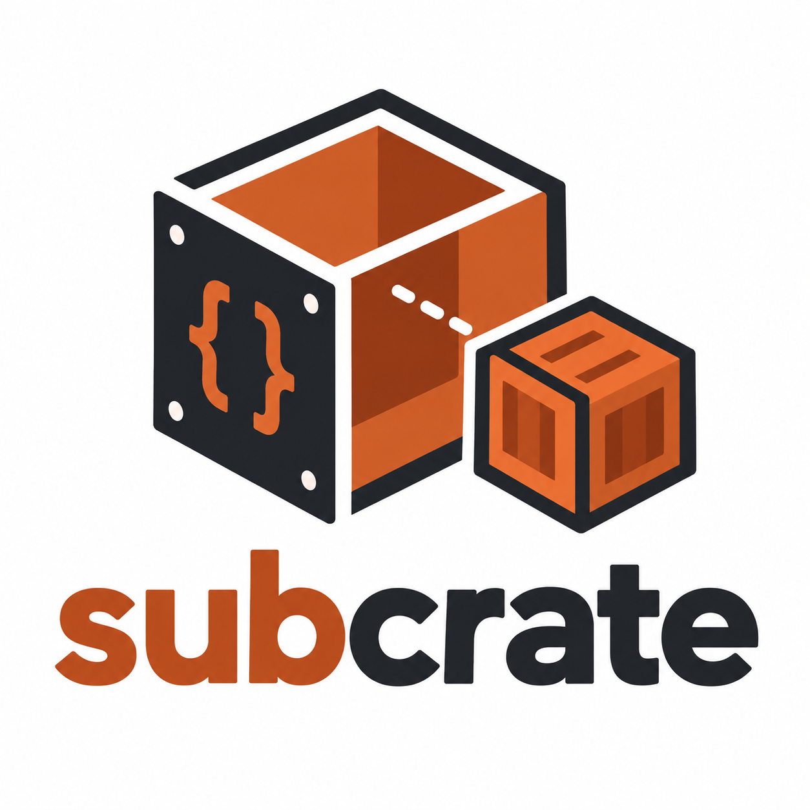

<p align="center">
  
</p>

# subcrate [![Latest Version]][crates.io] [![Documentation]][docs.rs] [![MSRV]][msrv-workflow]

[![Linux]][linux-workflow] [![Windows]][windows-workflow] [![macOS]][macos-workflow] [![Checks]][checks-workflow]

[Latest Version]: https://img.shields.io/crates/v/subcrate.svg
[crates.io]: https://crates.io/crates/subcrate
[Documentation]: https://img.shields.io/docsrs/subcrate
[docs.rs]: https://docs.rs/subcrate/latest/subcrate/
[MSRV]: https://img.shields.io/crates/msrv/subcrate.svg
[msrv-workflow]: https://github.com/yasuo-ozu/subcrate/actions/workflows/msrv.yml
[Linux]: https://github.com/yasuo-ozu/subcrate/actions/workflows/linux.yml/badge.svg
[linux-workflow]: https://github.com/yasuo-ozu/subcrate/actions/workflows/linux.yml
[Windows]: https://github.com/yasuo-ozu/subcrate/actions/workflows/windows.yml/badge.svg
[windows-workflow]: https://github.com/yasuo-ozu/subcrate/actions/workflows/windows.yml
[macOS]: https://github.com/yasuo-ozu/subcrate/actions/workflows/macos.yml/badge.svg
[macos-workflow]: https://github.com/yasuo-ozu/subcrate/actions/workflows/macos.yml
[Checks]: https://github.com/yasuo-ozu/subcrate/actions/workflows/checks.yml/badge.svg
[checks-workflow]: https://github.com/yasuo-ozu/subcrate/actions/workflows/checks.yml

**Write real, separately compiled Rust crates as inline modules.**

Put `#[subcrate]` on an inline module and its body is built as its own crate —
with its own crate root, its own `crate::`, and its own type identities and
orphan rules. The module keeps its name, place, and visibility in the crate
around it. You add no extra Cargo packages and no separate source files, and
everything runs under the usual `cargo build`, `check`, `test`, and `doc`.

```rust ignore
use subcrate::subcrate;

// A proc-macro crate, written inline.
#[subcrate(proc_macro = true)]
pub mod my_macro {
    use proc_macro::TokenStream;
    #[proc_macro]
    pub fn mac(_: TokenStream) -> TokenStream { "42".parse().unwrap() }
}

// An ordinary library crate.
#[subcrate]
pub mod my_crate {
    pub fn calc() -> usize { 32 }
}

// `#[subcrate]` works in nested modules too.
pub mod nested {
    use subcrate::subcrate;
    #[subcrate]
    pub mod inner {
        pub fn answer() -> usize { 42 }
    }
}

// A subcrate can depend on other subcrates — a sibling (`my_crate`) and a nested
// one (`nested::inner`, in scope under `inner`) — and on a crate the package
// itself depends on (`::syn`, the leading `::`).
#[subcrate(my_crate, nested::inner, ::syn)]
pub mod analyze {
    pub fn score(src: &str) -> usize {
        syn::parse_file(src).unwrap().items.len() + my_crate::calc() + inner::answer()
    }
}

pub fn calculate() -> usize {
    my_crate::calc() + nested::inner::answer() // 32 + 42
}
```

## Macros and ordinary items in one crate

A `proc-macro` crate can export only macros. With `subcrate`, an ordinary library
crate can hold proc-macros (as `#[subcrate(proc_macro = true)]` modules) beside its
normal items, and re-export them from its own root:

```rust ignore
#[subcrate(proc_macro = true)]
pub mod macros {
    use proc_macro::TokenStream;
    #[proc_macro]
    pub fn mac(_: TokenStream) -> TokenStream { "42".parse().unwrap() }
}

pub use macros::mac;             // now `thiscrate::mac!()` works...
pub fn ordinary() -> usize { 7 } // ...next to ordinary items, in one crate.
```

Attribute and derive macros are re-exported the same way.

## Setup

Three pieces, all required.

**`Cargo.toml`** — `subcrate` is both a normal and a build dependency:

```toml
[dependencies]
subcrate = "0.2"

[build-dependencies]
subcrate = "0.2"
```

**`build.rs`** — one required call:

```rust ignore
fn main() {
    subcrate::build::compile().unwrap();
}
```

**`src/lib.rs`** (or `main.rs`, a test, …) — write `use subcrate::subcrate;` and
put `#[subcrate]` on inline modules.

If the build helper never runs, `#[subcrate]` gives a clear compile error instead
of a confusing linker failure.

A crate that needs only the attribute, not `build::compile`, can leave the build
machinery out of its own build with `default-features = false`. `subcrate` is then
`#![no_std]`, so a `no_std` package can use it on a target without `std` (e.g.
`x86_64-unknown-none`). This needs feature resolver 2 (the default since edition 2021),
which keeps the build-dependency's default features out of the normal dependency:

```toml
[dependencies]
subcrate = { version = "0.2", default-features = false }

[build-dependencies]
subcrate = "0.2" # the build helper runs on the host, with the default features
```

## How it works

`subcrate::build::compile()` runs from your build script. It:

1. Finds the package's source files, from its crate roots (`src/lib.rs`,
   `src/main.rs`, `src/bin/*.rs`, `tests/*.rs`, `benches/*.rs`, `examples/*.rs`,
   and declared targets) through `mod foo;` and `#[path = "…"]`. It starts from
   `CARGO_MANIFEST_DIR`, so a published, extracted package works too. `autotests = false`
   (likewise `autobins`, `autobenches`, `autoexamples`) in `[package]` skips the files in
   `tests/` (…) unless a `[[test]]` (…) declares them, e.g. for another package in `tests/`.
2. Finds every `#[subcrate]` inline module in them.
3. Compiles each with `rustc` directly (from `$RUSTC`).
4. Puts the crates on the library search path and writes a small manifest the
   attribute macro reads to confirm the helper ran.

### Per-subcrate options

- `#[subcrate(proc_macro)]` (or `proc_macro = true`) — build the module as a
  `proc-macro` crate.
- `#[subcrate(edition = "2018")]` — build this one subcrate with a given edition
  instead of the package's.
- Crate-root inner attributes in the body (`#![no_std]`, `#![allow(…)]`, …) are
  applied to the subcrate's crate root.
- A subcrate body may split across files with `mod foo;` (`#[path]` included); the
  build helper inlines them before compiling, and editing one triggers a rebuild.
  This needs **nightly** Rust (`mod foo;` in proc-macro input is unstable, `E0658`,
  on stable); inline `mod foo { … }` works everywhere.

### Toolchain-conditional subcrates

Put a [`rustversion`] selector *above* `#[subcrate]` to make a subcrate available
only on toolchains that satisfy it:

```rust ignore
#[rustversion::nightly]
#[subcrate]
mod nightly_only {
    #![feature(portable_simd)]
    // …nightly-only code…
}
```

`rustversion` removes the module on a non-matching toolchain, so it is simply
absent there — guard your uses of it the same way (with `#[rustversion::…]` or
`#[cfg(…)]`). The build helper does not read the selector: it builds every
subcrate, and a *gated* one that fails to compile is taken to mean "not for this
toolchain" and **skipped**, so a non-matching toolchain never fails the build. (A
gated subcrate that fails on a toolchain where the gate *keeps* it still reports
the compiler's error, so genuine mistakes aren't hidden.) Place the selector above
`#[subcrate]`, not below it.

[`rustversion`]: https://crates.io/crates/rustversion

### UI testing

A subcrate can assert what the compiler says about it. Pass `#[subcrate(...)]` one
or more of these and the build helper checks `rustc`'s diagnostics:

- `should_error` — it must *fail* to compile. Such a subcrate produces no crate, so
  its module expands to an empty one. Add `= "…"` to also require an error whose
  text contains that string.
- `should_warn` — it must emit at least one warning. Add `= "…"` to require a
  warning whose text contains that string.
- `should_spanned = "…"` — some diagnostic must underline this code (compared with
  whitespace removed).

Each may be repeated, and **every one must hold** — they are combined with AND. For
example, two `should_error = "…"` require an error for *each* string (not just one
of them).

```rust ignore
#[subcrate(should_error = "cannot find value", should_spanned = "nope")]
mod ui_test {
    pub fn f() -> u32 { nope }
}
```

The checks run during a plain `cargo build`/`test`: if one is not met the build
fails and prints what the compiler actually said. A subcrate without `should_error`
must still compile, so it stays a real, usable crate; its asserted warnings are not
forwarded as build warnings. A UI-test subcrate is compiled with its lints capped at
`warn`, so a `should_warn` keeps working even when the rest of the build runs under
`-D warnings` (which would otherwise turn the warning into a hard error).

Because the checks run at build time rather than from a separate test, the warm
edit/run loop is quicker than [`trybuild`] on the same compile-fail cases (24 cases,
`rustc 1.101.0-nightly`; machine-dependent, so the ratios are the point — [details][bench]):

| scenario (seconds)                | subcrate    | trybuild    |
|-----------------------------------|-------------|-------------|
| cold (incl. framework build)      | 22.25       | 22.97       |
| no-op re-run (min / mean)         | 0.38 / 0.39 | 1.79 / 1.87 |
| one case edited (min / mean)      | 0.96 / 1.09 | 1.70 / 1.72 |
| all 24 cases rebuilt (min / mean) | 1.56 / 1.71 | 1.61 / 1.65 |

[`trybuild`]: https://crates.io/crates/trybuild
[bench]: https://github.com/yasuo-ozu/subcrate/tree/main/benchmarks

## Known limitations

- `cargo doc` on the defining crate works. But a *downstream* crate's `cargo doc`
  can't resolve a dependency's subcrate-backed
  items in documented code — Cargo forwards that path to `rustc`, not `rustdoc`.
  Guard such references with `#[cfg(not(doc))]`.
- That stand-in can import a sibling dependency only if it is in the same crate
  root (`src/lib.rs`, or the same test/bin/example file); a cross-root dependency
  has no `crate::` path, so references to it may not resolve under `cargo doc`.
- Under `cargo doc`, a `proc_macro` subcrate is replaced by a stand-in, since `rustdoc` cannot
  load the real crate: each `#[proc_macro]`, `#[proc_macro_attribute]` and
  `#[proc_macro_derive(Name)]` function becomes a `macro_rules!` macro with its doc comment
  (and its doc tests), so `pub use macros::{mac, attr, Name};` resolves. Its pages are all
  `macro.NAME.html`, and *applying* its attribute or derive in the documented package fails:
  guard those uses, and the derive's helper attributes, with `#[cfg_attr(not(doc), NAME)]`
  and `#[cfg_attr(not(doc), derive(NAME))]`. Builds, tests and doc tests use the real crate.
- A crate the package depends on (`#[subcrate(::syn)]`) is built by a nested, `--offline`
  `cargo build`. For a package built for a target (cross-compiling, or `--target` even for
  the host's triple, as Cargo then applies `RUSTFLAGS` to the target only), a proc-macro
  subcrate's crates are built for the **host** without the target's `RUSTFLAGS` (though
  `build.rustflags` from a config file still reaches them) and a library subcrate's for the
  target, so a `#![no_std]` library can have a proc-macro subcrate on `::syn`.
- Such a crate must be a normal dependency that the package's resolution enables for that
  platform. An optional one whose feature is off, or a dev-dependency, gives "did not match
  any packages". A build-dependency only, or one a `[target.'cfg(…)'.dependencies]` table
  leaves out, makes Cargo panic (the build says what to change). To keep it out of the
  bare-metal build, declare it for the host only:

  ```toml
  [target.'cfg(not(target_os = "none"))'.dependencies]
  syn = "2"
  ```
- When cross-compiling, a proc-macro subcrate cannot use `::this_package` or a library subcrate.
- A registry (git, vendored) package is built by that nested `cargo` in a private workspace:
  a stub that depends on it, not as a member, so its dev-dependencies are not resolved. It
  takes the outer build's features, versions (not the package's `Cargo.lock`), `[patch]` and
  `[replace]`; nothing is written into the package's directory. Cargo's configuration there
  (source replacement, mirror, `[net]`) applies.
- That workspace is found by its `Cargo.lock` above the target directory: with
  `CARGO_TARGET_DIR` outside it, there is no `[patch]`, `[replace]` or project configuration.
- `--config`, and configuration of a directory below the workspace root that the build was
  started in, are not seen.
- A `[replace]`d crate that a subcrate names (`::name`) is two packages of one name and
  version to `cargo build -p`: use `[patch]`.
- `cargo package -p a -p b` verifies a package against its not-yet-published sibling through
  that workspace (`crates.io` only).

## Related work

Defining extra crates inline has been [proposed for Rust itself][inline-crates]
(see the [lang-team discussion][lang-team-139]), but it is not available, and that
proposal leaves proc-macros out — the case where the separate-crate split hurts
most. `subcrate` works today on stable and handles proc-macros. Other crates ease
the two-crate proc-macro split in different ways, such as [`include_proc_macro`]
for pulling macro sources in from arbitrary paths, but none give an inline module
a real, separate crate identity.

[inline-crates]: https://blog.yoshuawuyts.com/inline-crates
[lang-team-139]: https://github.com/rust-lang/lang-team/issues/139
[`include_proc_macro`]: https://docs.rs/include_proc_macro

## License

Licensed under the [MIT license](./LICENSE).
